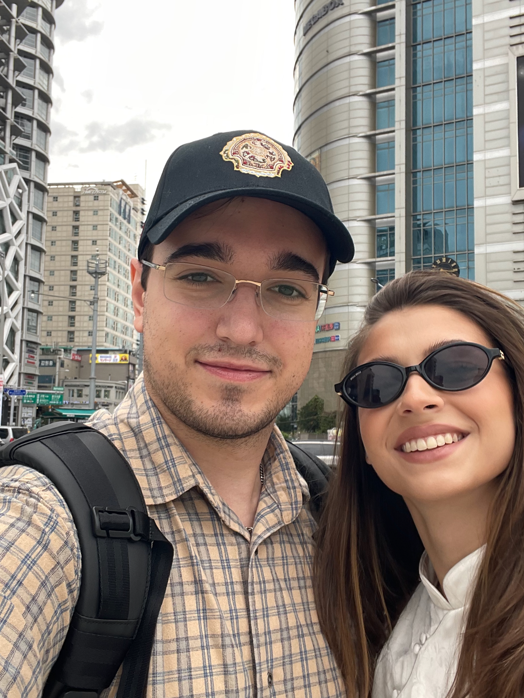

Заметка про Сеул. В сентябре случилось мое первое путешествие за границу. Мы отправились в столицу Южной Кореи — Сеул. Забавно, что в столице собственной страны я до сих пор ни разу не был.

Южную Корею мы выбрали не случайно. Какое-то время мы активно увлекались корейским кино. "Паразиты", "Олдбой", "Воспоминания об убийстве" настолько нас впечатлили, что захотелось поближе познакомиться с корейской культурой и увидеть страну своими глазами. К тому же Сеул — одна из мировых столиц шопинга, а Лиза это дело любит. В общем, решили — летим.

В Сеуле мы провели 10 дней и довольно много успели. За это время посмотрели исторические достопримечательности, погуляли по современным районам, полюбовались ночным городом со смотровой площадки, прошлись по магазинам и даже сходили в парк аттракционов.

Первое, что бросается в глаза — это чистота. На улицах практически нет мусора, хотя найти урну — та ещё задача. Отдельно хочется отметить метро: удобное, с огромным количеством станций. Впрочем, меня легко удивить, потому что я из Новосибирска, где всего 2 линии метро.

Приятно удивили и местные жители. Вежливые и уважительные к окружающим. В общественных местах приятно находиться. Кажется, что все стараются не мешать друг другу.

Но больше всего мне запомнился наш поход к Сеульской башне. Я решил просто построить пеший маршрут в навигаторе, даже не подумав заранее посмотреть, как туда обычно добираются. В итоге мы больше часа поднимались в гору по совершенно пустой дороге. Вокруг ни души, местами даже фонарей не было. Признаюсь, было немного страшно. Правда, по пути несколько раз попадались камеры наблюдения, и от этого становилось спокойнее. Вообще, камер в Сеуле очень много, поэтому чувствуешь себя довольно безопасно. Когда мы наконец добрались до вершины, часы показали, что мы поднялись на 120 этажей. И тут мы выходим к дороге, а к башне спокойно подъезжает автобус с довольными туристами. Оказалось, что сюда можно было добраться на автобусе или по канатной дороге. А мы стоим запыхавшиеся после часового подъёма.

Поездка стала для меня настоящим культурным шоком. Было ощущение, будто попал в совершенно другой мир, где всё устроено иначе. Это путешествие напомнило мне, ради чего стоит работать, развиваться и двигаться вперёд. Хочется больше зарабатывать, чаще путешествовать и открывать для себя новые места.

